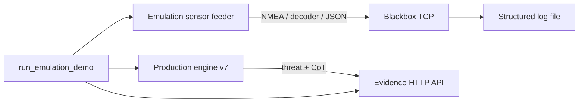
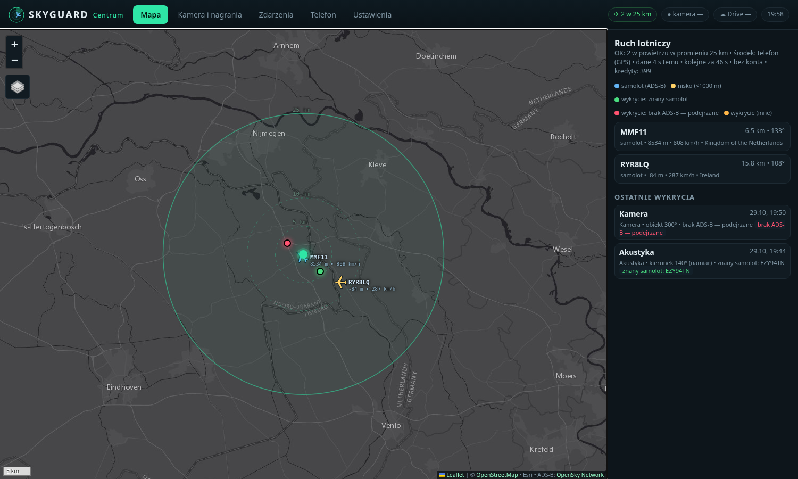
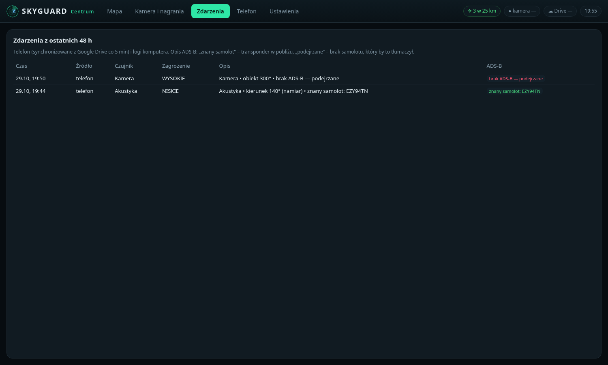
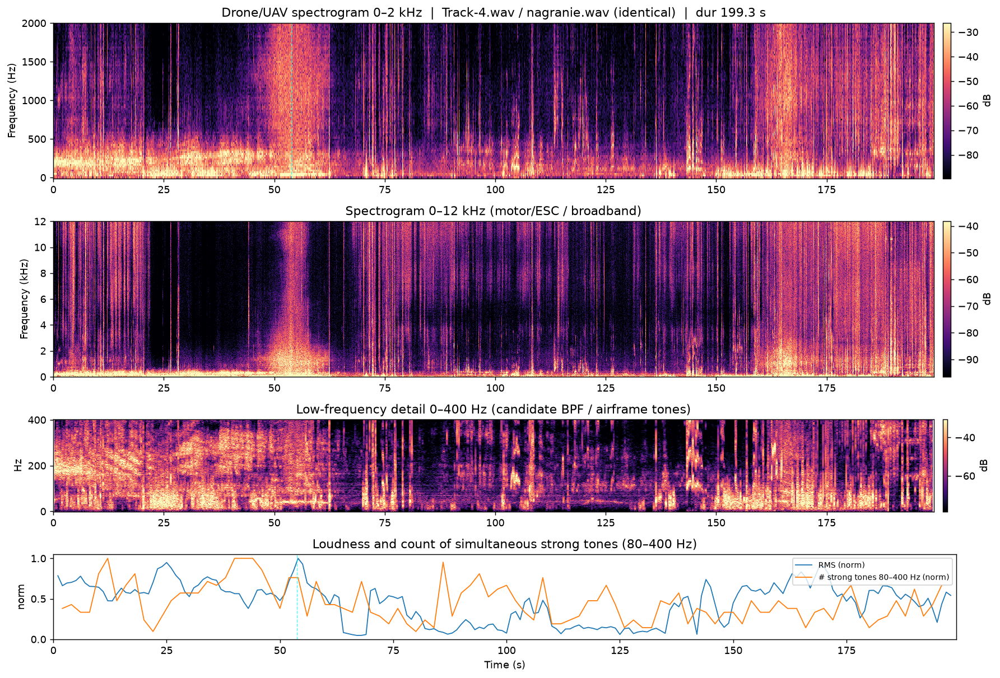

# SKYGUARD

Passive multi-sensor **counter-UAS (C-UAS)** research stack.

**Author:** Mateusz Ogrodowczyk · Arnhem / Nijmegen (NL) · self-taught programmer (mechanical-assembly background).

[](.github/workflows/ci.yml)
[](LICENSE)

---

## What this repository contains

- **Fusion engine (Python / NumPy / SciPy):** PCL ECA-B cancellation, FFT CAF, acoustic GCC-PHAT TDOA + BPF harmonics, adaptive UKF, threat scoring, Cursor-on-Target (CoT) XML, Pelco-D helper, SHA-256 audit trail helper (EU AI Act–aligned logging style)
- **Blackbox TCP hub:** async server for GPS NMEA + SIGINT decoder telemetry; USB serial when present, software feeder in emulation
- **Emulation mode:** synthetic sensor feed + evidence HTTP API (SHA-256 hash chain) — no cameras, SDR, or cloud billing required
- **Optional vision / PTZ scripts** (off by default): OpenCV MOG2 + Tapo smooth tracker
- **Deploy helpers:** systemd unit, GCP / Cloud Shell bootstrap, `skyguard` CLI
- **Extras:** Android / Centrum notes, acoustic C-UAS reference (+ tests), realtime DSP package (+ tests), Google Drive Apps Script relay
- **Screenshots:** Centrum UI + acoustic spectrogram

> Scope: personal engineering project. Some Android / Windows binaries exist separately and are not bundled here (size). See [`VERSIONS.md`](VERSIONS.md) for a short project history.

---

## Architecture (emulation)



Field setups (documented under `extras/`) can add Pixel Android nodes, Windows Centrum, laptop edge clients, and Tailscale.

---

## Quickstart

```bash
python3 -m venv .venv && source .venv/bin/activate
pip install -r requirements.txt pytest ruff

make demo          # or: ./scripts/run_demo.sh
make test          # unit + extras + e2e
make lint          # ruff on core modules
```

Docker (if installed):

```bash
docker compose run --rm skyguard-demo
docker compose run --rm skyguard-test
```

Master launcher (Blackbox + Fusion heartbeat; Pixel/PTZ off by default):

```bash
cd furnace/00_Master_Launcher
export SKYGUARD_ENV_FILE=../config/skyguard.env.example
./start_all.sh
```

---

## Layout

| Path | Role |
|------|------|
| `furnace/` | Project Furnace core |
| `furnace/lib/` | Shared config / logging |
| `furnace/07_Emulation/` | Synthetic feeder + e2e demo |
| `furnace/08_Evidence_API/` | Evidence / status HTTP API |
| `extras/` | Docs, acoustic C-UAS, realtime DSP, Drive relay |
| `deploy/` | GCP / Cloud Shell scripts |
| `screenshots/` | UI / spectrogram captures |
| `CV_SNIPPET.md` | EN / NL / PL CV bullets |

---

## Screenshots

| Centrum map | Events | Spectrogram |
|-------------|--------|-------------|
|  |  |  |

Also: `centrum_cam.png`, `centrum_phone.png`, `centrum_settings.png`.

---

## Configuration

Copy `furnace/config/skyguard.env.example` → `furnace/config/skyguard.env` (gitignored).

- No real passwords, API keys, or Tailscale auth keys are stored in the repo.
- Camera fields use `CAMERA_HOST` placeholders.
- `GEMINI_API_KEY` is optional; the engine runs fully offline without it.

---

## Tests & CI

| Suite | Expectation |
|-------|-------------|
| `furnace/06_Testy_Automatyczne/` | unittest (engine + emulation + config) |
| `extras/acoustic-cuas/` | pytest |
| `extras/realtime-dsp/skyguard/tests` | pytest |
| `run_emulation_demo.py` | e2e smoke |

Workflow: [`.github/workflows/ci.yml`](.github/workflows/ci.yml).

---

## Roadmap

- [ ] Persistent GCP VM once billing is linked
- [ ] Continue merging private monorepo work into releases
- [ ] Hardware bring-up checklist (Pixel node + PTZ over VPN)

---

## Licence & dual-use

MIT — see [`LICENSE`](LICENSE). Templates under `furnace/04_Certyfikacje_i_Dokumenty/` are documents, not certificates. Do not deploy jamming or unlawful interception.
